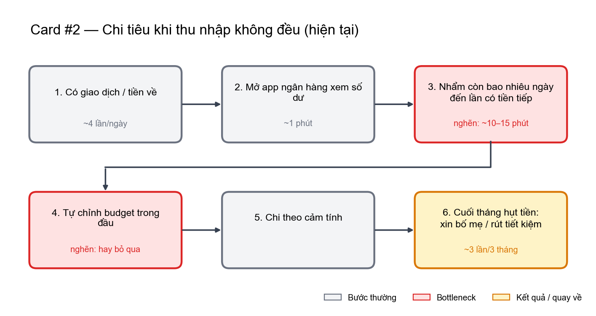
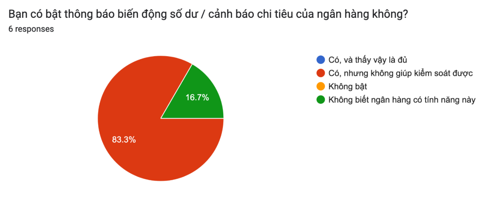
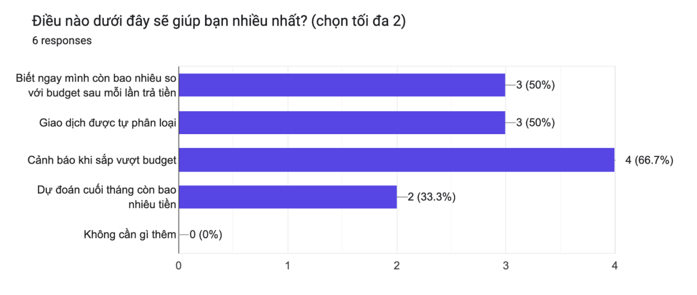
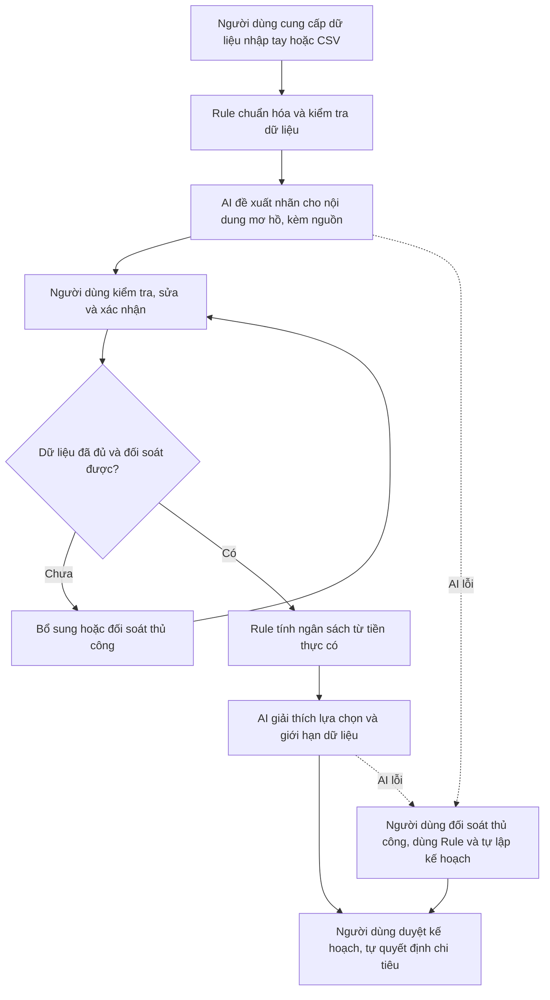
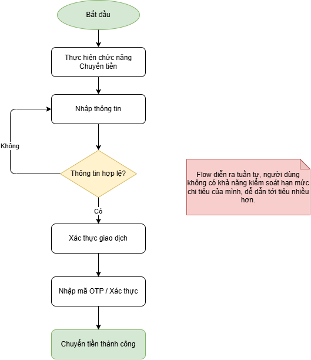
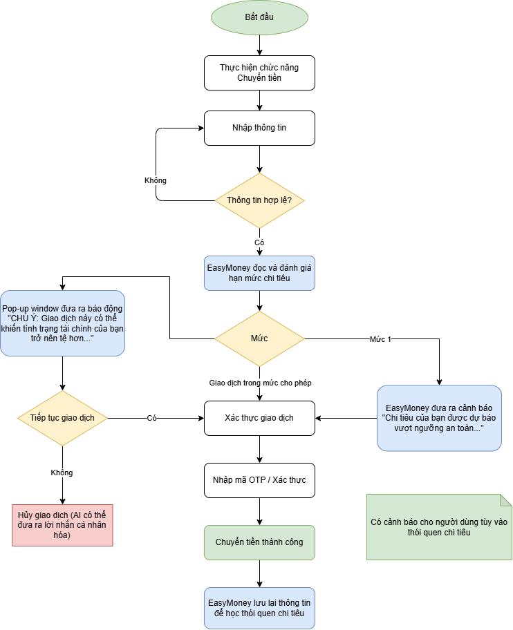

# Alpha — AI Transaction Intelligence

**Day 02 · K5 L3B · Báo cáo nhóm CP3–CP6**

Nhóm Alpha nghiên cứu khó khăn trong việc **đối soát tiền thực có và cập nhật ngân sách khi thu nhập không đều**. Trang này giới thiệu hướng bài toán, các hình minh chứng và đường dẫn đến bài làm chi tiết.

[Đọc báo cáo nhóm](report/team/group_report.md) · [Thành viên và đóng góp](TEAM.md) · [Kho minh chứng](report/assets/) · [Trang bài nhóm](report/team/README.md) · [Checkpoints](CHECKPOINTS.md)

## 1. Tổng quan bài toán

| Nội dung | Tóm tắt |
|---|---|
| Người dùng mục tiêu | Học viên, freelancer và người làm part-time có thu nhập không đều, tự theo dõi tiền ở ngân hàng, ví điện tử và tiền mặt. |
| Tình huống | Tiền về trễ, khoản chi phát sinh hoặc giao dịch khó hiểu làm kế hoạch chi tiêu cần được cập nhật. |
| Khó khăn chính | Dữ liệu phân tán; phải tự đối soát chi hộ, hoàn tiền và chuyển nội bộ, rồi tính lại khoản tiền còn dùng được. |
| Outcome mong muốn | Giảm công cập nhật kế hoạch và giảm nguy cơ thiếu tiền cho các khoản thiết yếu. |
| Phương án đề xuất | Workflow có Rule xử lý số liệu, AI hỗ trợ nội dung mơ hồ và người dùng kiểm tra, duyệt kết quả. |
| Quyết định hiện tại | **Not Yet** — cần đo baseline, kiểm tra dữ liệu và so sánh với Rule/công cụ có sẵn trước khi triển khai. |

Khi có biến động thu chi, người dùng muốn biết kế hoạch hiện tại còn phù hợp hay không và nên điều chỉnh khoản nào. “AI Transaction Intelligence” là tên hướng làm việc trong báo cáo; phần cần kiểm chứng vẫn là pain và giá trị giải quyết, chưa phải sản phẩm đã hoàn thiện.

## 2. Quy trình hiện tại và điểm nghẽn

Người dùng mở từng nguồn để xem số dư, tự nhẩm khoảng thời gian cần trang trải và chỉnh ngân sách trong đầu. Khi dữ liệu thiếu hoặc tình hình đổi liên tục, bước tính lại kế hoạch dễ bị bỏ qua.



*Minh chứng CP2 do Quỳnh Anh bổ sung. Các mốc thời gian và số lần hụt tiền trên hình là số liệu trong bản phác thảo cá nhân, chưa được xác nhận bằng log/bấm giờ; không dùng như baseline đã đo của nhóm.*

Phần [quy trình trước/sau trong báo cáo nhóm](report/team/group_report.md) tổng hợp thêm bước đối soát dữ liệu đa nguồn và tách rõ thời gian nhập liệu, tính toán, kiểm tra.

## 3. Kiểm chứng ban đầu: survey 6 người

### Thông báo biến động số dư đã đủ chưa?



- **5/6 người (83,3%)** chọn “Có, nhưng không giúp kiểm soát được”.
- **1/6 người (16,7%)** không biết ngân hàng có tính năng này.
- **0/6 người** chọn “Có, và thấy vậy là đủ”.

### Người trả lời muốn được hỗ trợ điều gì?



| Lựa chọn | Số người chọn | Tỷ lệ |
|---|---:|---:|
| Cảnh báo khi sắp vượt budget | 4/6 | 66,7% |
| Biết ngay còn bao nhiêu so với budget sau mỗi lần trả tiền | 3/6 | 50% |
| Giao dịch được tự phân loại | 3/6 | 50% |
| Dự đoán cuối tháng còn bao nhiêu tiền | 2/6 | 33,3% |
| Không cần gì thêm | 0/6 | 0% |

*Câu hỏi cho chọn tối đa 2 đáp án; tỷ lệ các lựa chọn không cộng thành 100%.*

Survey do **Vũ Ngọc Quỳnh Anh** thực hiện. Đây là tín hiệu nhu cầu ban đầu từ mẫu nhỏ; chưa rõ tiêu chí chọn mẫu hoặc người trả lời có thu nhập không đều hay không. Câu hỏi về mong muốn chưa chứng minh hành vi sử dụng hay sẵn sàng trả phí. Nhu cầu cảnh báo ngân sách có thể được đáp ứng bằng Rule, nên kết quả này chưa đủ để khẳng định cần AI hoặc Agent. Chi tiết diễn giải ở mục 3.2 của [báo cáo nhóm](report/team/group_report.md).

## 4. Workflow đề xuất để kiểm thử



Đây là luồng **đề xuất trong bản tổng hợp**, chưa có kết quả chạy thử. AI không tự xác nhận giao dịch, thay số liệu gốc, chuyển tiền hoặc đầu tư. Khoản tiền dự kiến chưa nhận không được cộng vào tiền thực có. Nếu dữ liệu thiếu hoặc chưa đối soát, công cụ chưa đưa ra ngân sách mới.

Mục tiêu pilot là giảm thời gian toàn quy trình, tính cả công review và sửa lỗi; so sánh Workflow với thao tác thủ công và Rule trên cùng tình huống. Các ngưỡng mục tiêu, tiêu chí đánh giá và điều kiện dừng nằm ở mục 7–8 của [báo cáo nhóm](report/team/group_report.md), chưa phải kết quả đã đạt.

### Hình phác thảo bổ sung từ giai đoạn thảo luận

**Luồng chuyển tiền hiện tại** — hình do Thành Vinh bổ sung, mô tả nhập thông tin, kiểm tra hợp lệ và người dùng xác thực giao dịch.



**Ý tưởng cảnh báo EasyMoney** — phác thảo thêm bước đọc hạn mức và cảnh báo trước khi người dùng xác nhận tiếp tục.



Hai ảnh ghi nhận ý tưởng ở giai đoạn thảo luận, **không phải thiết kế đã triển khai hoặc bằng chứng đã tích hợp ngân hàng**. Phác thảo EasyMoney đặt cảnh báo trong luồng thanh toán, rộng hơn phạm vi prototype nhập tay/CSV ở sơ đồ đề xuất phía trên. Trong phương án hiện tại, AI chỉ hỗ trợ lập kế hoạch; người dùng thực hiện giao dịch bằng ứng dụng của họ.

## 5. Thành viên và bài làm cá nhân

| Thành viên | MSSV | Báo cáo |
|---|---|---|
| Nguyễn Thị Khánh Linh | 2A202603845 | [Báo cáo cá nhân](report/individual/2A202603845_NguyenThiKhanhLinh.md) |
| Đỗ Thị Thu Hằng | 2A202603840 | [Báo cáo cá nhân](report/individual/2A202603840_DoThiThuHang.md) |
| Trần Thành Vinh | 2A202603821 | [Báo cáo cá nhân](report/individual/2A202603821_TranThanhVinh.md) |
| Vũ Ngọc Quỳnh Anh | 2A202603875 | [Báo cáo cá nhân](report/individual/2A202603875_VuNgocQuynhAnh.md) |

Vai trò, phân công theo checkpoint và bằng chứng đóng góp được ghi trong [TEAM.md](TEAM.md).

## 6. Hướng dẫn đọc bài nhóm

| Phần bài làm | Nội dung cần xem | Vị trí trong báo cáo nhóm |
|---|---|---|
| CP3 — Hội tụ | 12 candidate, cluster, OST, shortlist và lý do chọn/loại | Mục 2 |
| CP4 — Kiểm chứng và research | Assumption Map, survey, tín hiệu phản bác và giải pháp có sẵn | Mục 3 |
| CP5 — Quy trình và Problem Statement v0 | Actor, input/output, bottleneck, before/after, boundary và fallback | Mục 4–5 |
| CP6 — Mức can thiệp và quyết định | No AI/Rule/Workflow/Agent, AI Canvas, v1, eval, rủi ro và ngưỡng dừng | Mục 6–8 |
| Hạn chế và nguồn | Bằng chứng còn thiếu, hướng tiếp theo và tài liệu tham khảo | Mục 9–10 |

Báo cáo nhóm dùng chung một bản tại [group_report.md](report/team/group_report.md) trên repo nhóm. Báo cáo cá nhân đặt trong `report/individual/`; ảnh và minh chứng đặt trong `report/assets/`. Không sao chép báo cáo nhóm hoặc `TEAM.md` sang repo cá nhân.

## 7. Bước tiếp theo

1. Làm rõ đối tượng trả lời survey và bổ sung phỏng vấn về tình huống đã xảy ra với người ngoài nhóm.
2. Đo thời gian và kiểm tra độ đầy đủ của dữ liệu trước khi đặt baseline.
3. Thử Rule và công cụ có sẵn, sau đó kiểm tra giá trị bổ sung của AI bằng cùng bộ tình huống.
4. Nhóm xác nhận phạm vi, phân công và mức can thiệp; giữ **Not Yet** cho đến khi đủ điều kiện trong báo cáo.

---

<details>
<summary>Hướng dẫn bài lab gốc và tài liệu học tập</summary>

## K5 · L3 · Day 02 — Discovery & Problem Framing

> **Loại bài: Cá nhân + Nhóm.** Một phần làm cá nhân (CP1, CP2, CP7), một phần làm theo nhóm 3–4 người (CP3–CP6). **Mỗi nhóm làm chung một repo do nhóm trưởng fork.** Mỗi học viên vẫn nộp link repo đó trên LMS bằng tài khoản của mình. Xem [SUBMISSION.md](SUBMISSION.md).

Hôm nay bạn chưa xây AI. Hôm nay bạn **tìm đúng bài toán**: đi từ một vấn đề thật quanh mình, vẽ quy trình, viết Problem Statement đủ chặt, kiểm chứng với người thật, rồi mới quyết định có nên dùng AI không. Nếu dùng thì ở mức nào: Rule, Workflow hay Agent. Cuối cùng là kết luận **Go / Not Yet / No-Go**.

Lab này đi theo **nửa đầu của mô hình Double Diamond** (Design Council, UK):

```text
     DISCOVER (mở rộng)              DEFINE (thu hẹp)
   ◇ cá nhân scan rộng  ──────▶  ◇ nhóm hội tụ về 1 Problem Statement
   CP1 → CP2                       CP3 → CP4 → CP5 → CP6
```

Đầu ra cuối cùng là **một Problem Statement đã kiểm chứng và một quyết định có lý do**, chưa phải một sản phẩm. Kết luận "không cần AI" vẫn là một kết luận tốt nếu lập luận chặt.

### Mục tiêu học tập

Sau buổi này, bạn làm được:

1. Mô tả một vấn đề theo **actor, quy trình, bottleneck, metric**, không bắt đầu từ giải pháp (Job Story, Opportunity Solution Tree).
2. Kiểm chứng một vấn đề bằng **bằng chứng về hành vi đã xảy ra**, không dựa vào ý kiến hay lời khen (The Mom Test).
3. Viết **Problem Statement** có success metric đo được, boundary rõ và tiêu chí đánh giá AI (Lean UX, Google PAIR).
4. Chọn đúng mức can thiệp **No AI / Rule / Workflow / Agent** và ra quyết định theo **4 rủi ro** Value, Usability, Feasibility, Viability (Anthropic, Marty Cagan).

### Thông tin chung

| Mục | Nội dung |
|---|---|
| Khóa / level | K5 · Level 3, lớp **L3A** hoặc **L3B** (cùng một đề, khác nhau ở tên repo nộp bài) |
| Ngày học | Day 02 |
| Thời lượng | 4 tiếng (240 phút, gồm 2 lần nghỉ 10 phút) |
| Nhóm | 3–4 người |
| Chuẩn bị | Tài khoản GitHub; một công cụ vẽ quy trình (giấy, Mermaid, Excalidraw hoặc FigJam); một trợ lý AI (ví dụ ChatGPT hoặc Gemini) |
| Code | Không có code. Toàn bộ bài làm là file Markdown và hình ảnh |
| Deadline | Lab sáng: 23h59 GMT+7 ngày lab. Lab chiều/tối: 11h59 GMT+7 ngày hôm sau. Chi tiết trong [SUBMISSION.md](SUBMISSION.md) |

### Bắt đầu

1. **Nhóm trưởng** bấm **Fork** (góc trên bên phải repo này). Ở trang *Create a new fork*, chọn tài khoản GitHub của nhóm trưởng làm **Owner** và sửa ô **Repository name** theo cú pháp:
   ```text
    K5-<L3A hoặc L3B>-DAY02-TenNhom-DiscoveryProblemFraming
   ```

    Ví dụ lớp L3A: `K5-L3A-DAY02-NhomABC-DiscoveryProblemFraming`. Lớp L3B: `K5-L3B-DAY02-NhomABC-DiscoveryProblemFraming`.

    Lưu ý khi fork:
   - Nếu lỡ để tên mặc định, vào **Settings → General → Repository name** trong repo fork để đổi tên.
   - Cả nhóm làm bài và commit trên **đúng repo fork này**. Không tạo Pull Request về repo gốc. Không fork thêm repo cá nhân.
   - Nhóm trưởng vào **Settings → Collaborators**, mời các thành viên. Mỗi người chấp nhận lời mời rồi mới commit được.
   - Repo fork có cùng chế độ public/private với repo gốc và không tự đổi được. Nếu fork là private, thêm coach làm collaborator theo hướng dẫn trên LMS.
   - Mỗi thành viên nộp **cùng một link** repo này trên LMS bằng tài khoản của mình. Chi tiết trong [SUBMISSION.md](SUBMISSION.md).
2. Mỗi thành viên tạo **một file báo cáo cá nhân** trong `report/individual/` trên repo chung: copy `MSSV_HoTen.md` thành file mới, đặt tên MSSV và họ tên của mình, ví dụ `report/individual/20241234_NguyenVanAn.md`. Giữ template cho đến khi mọi người đã có file riêng, rồi xóa template. Commit bằng tài khoản GitHub của chính mình. Không viết hộ lẫn nhau.
3. Đọc tài liệu theo thứ tự dưới đây, rồi làm lần lượt từ CP0 đến CP7.

### Thuật ngữ

Lab giữ nguyên một số thuật ngữ tiếng Anh vì đây là từ các team product dùng hằng ngày. Nghĩa trong lab:

| Thuật ngữ | Nghĩa trong lab |
|---|---|
| **Quy trình** | Các bước con người đang làm để xong một việc (quy trình hiện tại, quy trình tương lai). Vẽ ở CP2 và CP5 |
| **Workflow** (viết hoa) | Chỉ dùng cho **một mức can thiệp AI** trong 4 mức No AI / Rule / Workflow / Agent: các bước định sẵn, AI làm một phần. Không dùng để chỉ quy trình làm việc |
| **Problem / pain** | Vấn đề, nỗi đau có thật: tốn thời gian, hay sai, bị than phiền nhiều lần |
| **Candidate (problem)** | Một vấn đề được đề cử để nhóm cân nhắc. Shortlist là danh sách rút gọn các candidate |
| **Bottleneck** | Bước nghẽn: một bước cụ thể trong quy trình làm chậm hoặc làm hỏng cả quy trình |
| **Problem Statement (v0 / v1)** | Bản mô tả bài toán. v0 viết sau CP5, v1 bổ sung mức can thiệp AI ở CP6 |
| **Claim** | Một nhận định cần có nguồn để kiểm chứng |
| **Narrative** | Phần nhận định viết bằng chữ (khác phần số liệu) |
| **Boundary** | Ranh giới: những gì AI không được làm hoặc không được tự quyết |
| **Eval / tiêu chí đánh giá** | Tiêu chí để chấm đầu ra của AI là đạt hay không đạt. Bộ eval là tập ví dụ đầu vào kèm đầu ra mong đợi để chấm theo các tiêu chí đó |

### Thứ tự đọc

| # | File | Đọc để biết |
|---|---|---|
| 1 | [RULES.md](RULES.md) | Được và không được dùng AI ở đâu, quy định nhóm và nộp muộn |
| 2 | [CHECKPOINTS.md](CHECKPOINTS.md) | 8 checkpoint: làm gì, nộp gì, tự kiểm thế nào |
| 3 | [docs/01-worksheet.md](docs/01-worksheet.md) | Hướng dẫn chi tiết, template và prompt mẫu cho từng checkpoint |
| 4 | [docs/02-deliverable-example.md](docs/02-deliverable-example.md) | Một bài làm mẫu hoàn chỉnh |
| 5 | [RUBRIC.md](RUBRIC.md) | Cách chấm 100 điểm và bonus |
| 6 | [SUBMISSION.md](SUBMISSION.md) | Tên repo, cấu trúc, deadline, checklist trước khi nộp |
| — | [docs/03-international-frameworks.md](docs/03-international-frameworks.md) | Các framework quốc tế mà lab sử dụng, kèm nguồn gốc (đọc thêm) |

### Cấu trúc repo

```text
K5-<L3A hoặc L3B>-DAY02-TenNhom-DiscoveryProblemFraming/
├── README.md
├── RULES.md
├── CHECKPOINTS.md
├── RUBRIC.md
├── SUBMISSION.md
├── TEAM.md                          ← điền trên repo chung; mỗi người tự điền phần của mình
├── docs/                            ← worksheet, bài mẫu, framework (chỉ đọc)
├── report/
│   ├── individual/                  ← mỗi thành viên một file, ví dụ 20241234_NguyenVanAn.md
│   ├── team/group_report.md         ← phần NHÓM: CP3 → CP6, một bản trên repo chung
│   └── assets/                      ← ảnh quy trình, Mermaid, ảnh survey, ghi chú phỏng vấn
└── src/                             ← lab này không có code (xem src/README.md)
```

### Lịch buổi lab

| Thời gian | Checkpoint | Làm | Giai đoạn |
|---:|---|---|---|
| 15' | CP0 | Đọc bài mẫu | — |
| 25' | CP1 | Cá nhân scan 5+ problems | Discover |
| 35' | CP2 | Top 3 Problem Cards + quy trình nháp | Discover |
| 10' | — | Nghỉ | |
| 30' | CP3 | Nhóm hội tụ về 1 candidate | Define |
| 30' | CP4 | Kiểm chứng + research giải pháp đã có | Define |
| 45' | CP5 | Quy trình trước/sau + Problem Statement v0 | Define |
| 10' | — | Nghỉ | |
| 25' | CP6 | Rule / Workflow / Agent + Problem Statement v1 + quyết định | Define |
| 15' | CP7 | Reflection cá nhân | — |

</details>
