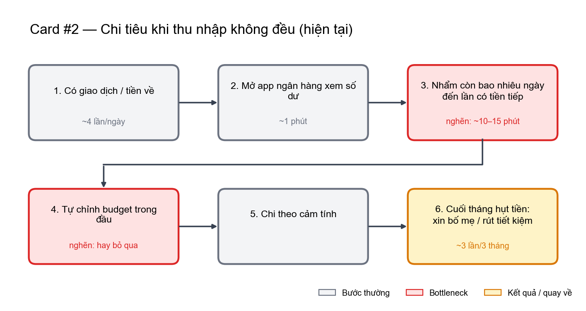
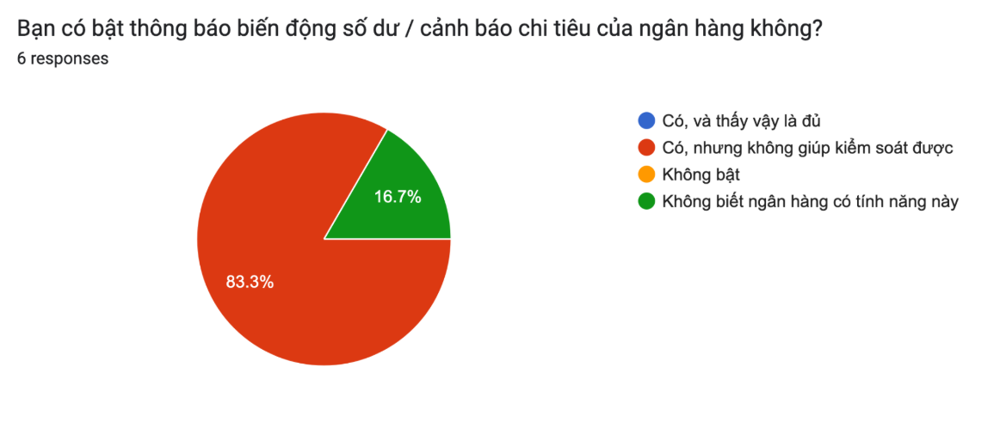
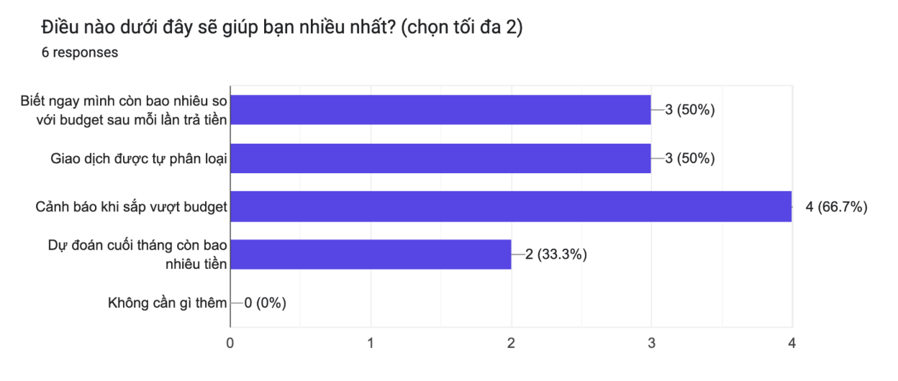
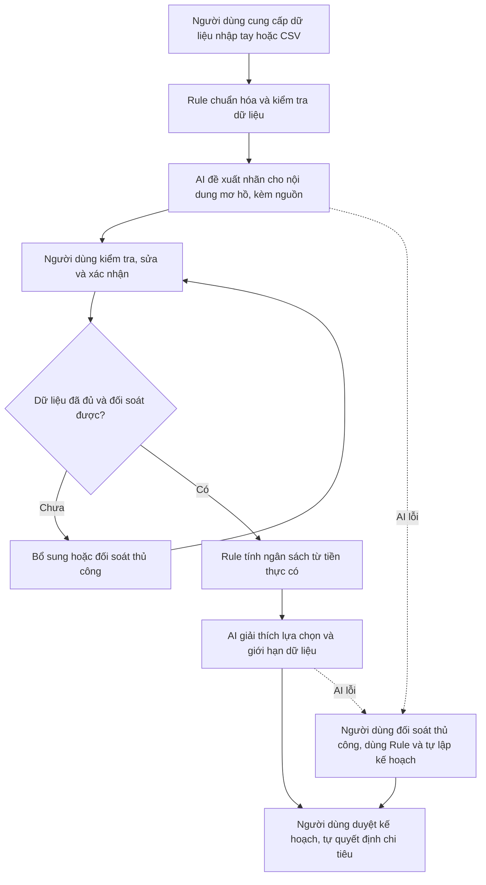
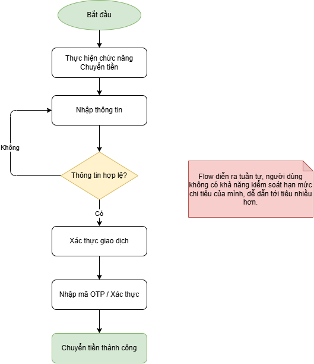
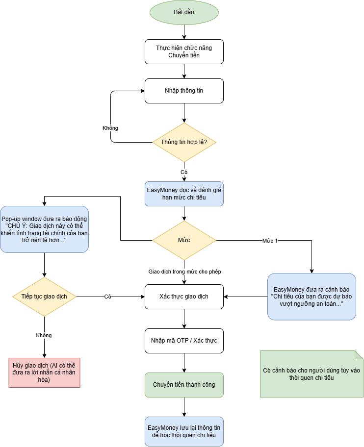

# Alpha — Discovery & Problem Framing

**Day 02 · K5 L3B · Báo cáo nhóm CP3–CP6**

Nhóm Alpha nghiên cứu khó khăn trong việc **đối soát tiền thực có và cập nhật ngân sách khi thu nhập không đều**. Trang này giới thiệu hướng bài toán, các hình minh chứng và đường dẫn đến bài làm chi tiết.

[Đọc báo cáo nhóm](group_report.md) · [Thành viên và đóng góp](../../TEAM.md) · [Kho minh chứng](../assets/) · [Checkpoints](../../CHECKPOINTS.md)

## 1. Tổng quan bài toán

| Nội dung | Tóm tắt |
|---|---|
| Người dùng mục tiêu | Học viên, freelancer và người làm part-time có thu nhập không đều, tự theo dõi tiền ở ngân hàng, ví điện tử và tiền mặt. |
| Tình huống | Tiền về trễ, khoản chi phát sinh hoặc giao dịch khó hiểu làm kế hoạch chi tiêu cần được cập nhật. |
| Khó khăn chính | Dữ liệu phân tán; phải tự đối soát chi hộ, hoàn tiền và chuyển nội bộ, rồi tính lại khoản tiền còn dùng được. |
| Outcome mong muốn | Giảm công cập nhật kế hoạch và giảm nguy cơ thiếu tiền cho các khoản thiết yếu. |
| Phương án đề xuất | Workflow có Rule xử lý số liệu, AI hỗ trợ nội dung mơ hồ và người dùng kiểm tra, duyệt kết quả. |
| Quyết định hiện tại | **Not Yet** — cần đo baseline, kiểm tra dữ liệu và so sánh với Rule/công cụ có sẵn trước khi triển khai. |

Khi có biến động thu chi, người dùng muốn biết kế hoạch hiện tại còn phù hợp hay không và nên điều chỉnh khoản nào. “AI Transaction Intelligence” là tên hướng làm việc trong báo cáo; phần cần kiểm chứng vẫn là pain và giá trị giải quyết, chưa phải sản phẩm đã hoàn thiện.

## 2. Quy trình hiện tại và điểm nghẽn

Người dùng mở từng nguồn để xem số dư, tự nhẩm khoảng thời gian cần trang trải và chỉnh ngân sách trong đầu. Khi dữ liệu thiếu hoặc tình hình đổi liên tục, bước tính lại kế hoạch dễ bị bỏ qua.

*Minh chứng CP2 do Quỳnh Anh bổ sung. Các mốc thời gian và số lần hụt tiền trên hình là số liệu trong bản phác thảo cá nhân, chưa được xác nhận bằng log/bấm giờ; không dùng như baseline đã đo của nhóm.*

Phần [quy trình trước/sau trong báo cáo nhóm](group_report.md) tổng hợp thêm bước đối soát dữ liệu đa nguồn và tách rõ thời gian nhập liệu, tính toán, kiểm tra.

## 3. Kiểm chứng ban đầu: survey 6 người

### Thông báo biến động số dư đã đủ chưa?

- **5/6 người (83,3%)** chọn “Có, nhưng không giúp kiểm soát được”.
- **1/6 người (16,7%)** không biết ngân hàng có tính năng này.
- **0/6 người** chọn “Có, và thấy vậy là đủ”.

### Người trả lời muốn được hỗ trợ điều gì?

| Lựa chọn | Số người chọn | Tỷ lệ |
|---|---:|---:|
| Cảnh báo khi sắp vượt budget | 4/6 | 66,7% |
| Biết ngay còn bao nhiêu so với budget sau mỗi lần trả tiền | 3/6 | 50% |
| Giao dịch được tự phân loại | 3/6 | 50% |
| Dự đoán cuối tháng còn bao nhiêu tiền | 2/6 | 33,3% |
| Không cần gì thêm | 0/6 | 0% |

*Câu hỏi cho chọn tối đa 2 đáp án; tỷ lệ các lựa chọn không cộng thành 100%.*

Survey do **Vũ Ngọc Quỳnh Anh** thực hiện. Đây là tín hiệu nhu cầu ban đầu từ mẫu nhỏ; chưa rõ tiêu chí chọn mẫu hoặc người trả lời có thu nhập không đều hay không. Câu hỏi về mong muốn chưa chứng minh hành vi sử dụng hay sẵn sàng trả phí. Nhu cầu cảnh báo ngân sách có thể được đáp ứng bằng Rule, nên kết quả này chưa đủ để khẳng định cần AI hoặc Agent. Chi tiết diễn giải ở mục 3.2 của [báo cáo nhóm](group_report.md).

## 4. Workflow đề xuất để kiểm thử

Đây là luồng **đề xuất trong bản tổng hợp**, chưa có kết quả chạy thử. AI không tự xác nhận giao dịch, thay số liệu gốc, chuyển tiền hoặc đầu tư. Khoản tiền dự kiến chưa nhận không được cộng vào tiền thực có. Nếu dữ liệu thiếu hoặc chưa đối soát, công cụ chưa đưa ra ngân sách mới.

Mục tiêu pilot là giảm thời gian toàn quy trình, tính cả công review và sửa lỗi; so sánh Workflow với thao tác thủ công và Rule trên cùng tình huống. Các ngưỡng mục tiêu, tiêu chí đánh giá và điều kiện dừng nằm ở mục 7–8 của [báo cáo nhóm](group_report.md), chưa phải kết quả đã đạt.

### Hình phác thảo bổ sung từ giai đoạn thảo luận

Xem luồng chuyển tiền hiện tại và ý tưởng cảnh báo EasyMoney

**Luồng chuyển tiền hiện tại** — hình do Thành Vinh bổ sung, mô tả nhập thông tin, kiểm tra hợp lệ và người dùng xác thực giao dịch.

**Ý tưởng cảnh báo EasyMoney** — phác thảo thêm bước đọc hạn mức và cảnh báo trước khi người dùng xác nhận tiếp tục.

Hai ảnh ghi nhận ý tưởng ở giai đoạn thảo luận, **không phải thiết kế đã triển khai hoặc bằng chứng đã tích hợp ngân hàng**. Phác thảo EasyMoney đặt cảnh báo trong luồng thanh toán, rộng hơn phạm vi prototype nhập tay/CSV ở sơ đồ đề xuất phía trên. Trong phương án hiện tại, AI chỉ hỗ trợ lập kế hoạch; người dùng thực hiện giao dịch bằng ứng dụng của họ.

## 5. Thành viên và bài làm cá nhân

| Thành viên | MSSV | Báo cáo |
|---|---|---|
| Nguyễn Thị Khánh Linh | 2A202603845 | [Báo cáo cá nhân](../individual/2A202603845_NguyenThiKhanhLinh.md) |
| Đỗ Thị Thu Hằng | 2A202603840 | [Báo cáo cá nhân](../individual/2A202603840_DoThiThuHang.md) |
| Trần Thành Vinh | 2A202603821 | [Báo cáo cá nhân](../individual/2A202603821_TranThanhVinh.md) |
| Vũ Ngọc Quỳnh Anh | 2A202603875 | [Báo cáo cá nhân](../individual/2A202603875_VuNgocQuynhAnh.md) |

Vai trò, phân công theo checkpoint và bằng chứng đóng góp được ghi trong [TEAM.md](../../TEAM.md).

## 6. Hướng dẫn đọc bài nhóm

| Phần bài làm | Nội dung cần xem | Vị trí trong báo cáo nhóm |
|---|---|---|
| CP3 — Hội tụ | 12 candidate, cluster, OST, shortlist và lý do chọn/loại | Mục 2 |
| CP4 — Kiểm chứng và research | Assumption Map, survey, tín hiệu phản bác và giải pháp có sẵn | Mục 3 |
| CP5 — Quy trình và Problem Statement v0 | Actor, input/output, bottleneck, before/after, boundary và fallback | Mục 4–5 |
| CP6 — Mức can thiệp và quyết định | No AI/Rule/Workflow/Agent, AI Canvas, v1, eval, rủi ro và ngưỡng dừng | Mục 6–8 |
| Hạn chế và nguồn | Bằng chứng còn thiếu, hướng tiếp theo và tài liệu tham khảo | Mục 9–10 |

Báo cáo nhóm dùng chung một bản tại [group_report.md](group_report.md) trên repo nhóm. Báo cáo cá nhân đặt trong `report/individual/`; ảnh và minh chứng đặt trong `report/assets/`. Không sao chép báo cáo nhóm hoặc `TEAM.md` sang repo cá nhân.

## 7. Bước tiếp theo

1. Làm rõ đối tượng trả lời survey và bổ sung phỏng vấn về tình huống đã xảy ra với người ngoài nhóm.
2. Đo thời gian và kiểm tra độ đầy đủ của dữ liệu trước khi đặt baseline.
3. Thử Rule và công cụ có sẵn, sau đó kiểm tra giá trị bổ sung của AI bằng cùng bộ tình huống.
4. Nhóm xác nhận phạm vi, phân công và mức can thiệp; giữ **Not Yet** cho đến khi đủ điều kiện trong báo cáo.
