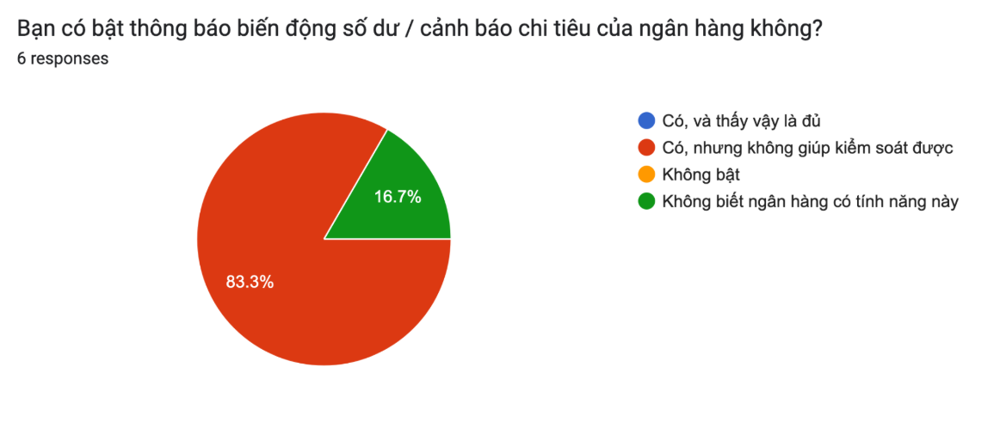
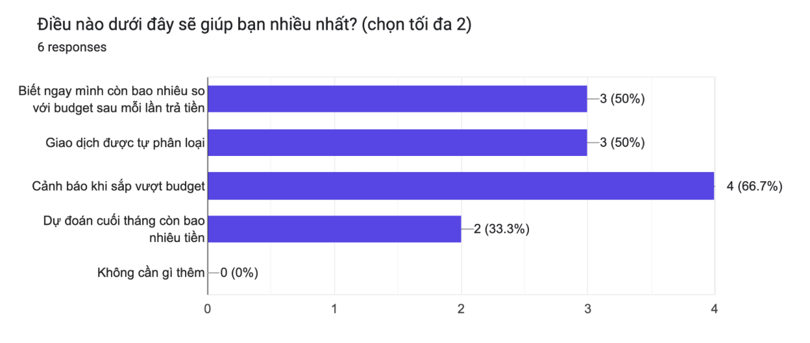

# Báo cáo nhóm — Day 02 Discovery & Problem Framing

> Bản chung của nhóm, viết trên repo do nhóm trưởng fork. Không copy file này sang repo cá nhân.
> Template chi tiết và prompt mẫu: [docs/01-worksheet.md](../../docs/01-worksheet.md). Bài mẫu: [docs/02-deliverable-example.md](../../docs/02-deliverable-example.md).

## 1. Thông tin nhóm

- Tên nhóm: Alpha
- Thành viên: Nguyễn Thị Khánh Linh (2A202603845), Đỗ Thị Thu Hằng (2A202603840), Trần Thành Vinh (2A202603821), Vũ Ngọc Quỳnh Anh (2A202603875); thông tin đóng góp cần được từng người xác nhận trong `TEAM.md`.
- Candidate problem được chọn (1 câu): Khi thu nhập về không đều và tiền nằm ở nhiều nguồn, học viên làm freelance/part-time khó đối soát giao dịch và tính lại ngân sách theo tiền thực có để biết mức chi phù hợp trước kỳ rà soát tiếp theo, làm tăng nguy cơ hụt tiền cho các khoản thiết yếu.
- Quyết định cuối: **Not Yet** — tiếp tục kiểm chứng nhu cầu, dữ liệu đầu vào và lợi ích so với Rule/công cụ có sẵn trước khi triển khai.


---

## 2. Hội tụ nhóm (CP3)

### 2.1. Pitch

| # | Người đưa ra | Candidate (Job Story ngắn) | Actor | Bottleneck | Câu hỏi phản biện nhận được (ai hỏi) |
|---:|---|---|---|---|---|
| 1 | Khánh Linh — Card #1 | Khi xử lý nhiều phức hợp protein, muốn giảm thao tác lặp lại để mở rộng thí nghiệm và giữ kết quả kiểm chứng được. | Sinh viên nghiên cứu protein–protein | Chuẩn bị chain/input, căn chỉnh và tổng hợp; chưa đo phút/phức hợp. | Linh chuẩn bị câu hỏi: Python script đã đủ chưa? Chưa ghi người phản biện trực tiếp. |
| 2 | Khánh Linh — Card #2 | Khi nhận góp ý qua nhiều nhiệm vụ, muốn nhận ra lỗi tái diễn để không mắc lại. | Sinh viên/người học kỹ năng | Tìm lại và đối chiếu phản hồi; chưa đo thời gian. | Đề xuất bổ sung: lỗi giống nhau có cùng nguyên nhân không? Chưa ghi người hỏi. |
| 3 | Khánh Linh — Card #3 | Khi thông tin nằm ở nhiều ứng dụng, muốn tìm đúng phiên bản để thực hiện đúng yêu cầu. | Sinh viên làm dự án/người đi làm | Tìm nguồn, đối chiếu và xác minh mâu thuẫn; chưa đo. | Đề xuất bổ sung: gom thư mục và quản lý phiên bản đã đủ chưa? Chưa ghi người hỏi. |
| 4 | Thu Hằng — Card #1 | Khi họp xong, muốn rõ quyết định, ai làm gì và hạn nào để không quên việc. | Người ghi biên bản/trưởng nhóm | Tách quyết định và đầu việc khoảng 15 phút; tổng khoảng 60 phút/buổi, là ước tính. | Hằng chuẩn bị câu hỏi về hậu quả gán sai người/hạn và bước xác nhận; chưa ghi người hỏi trực tiếp. |
| 5 | Thu Hằng — Card #2 | Khi mua online, muốn so sánh giá cuối và đánh giá để chọn nhanh, tránh mua hớ. | Người mua hàng cá nhân | Đọc và lọc review khoảng 12 phút; tổng khoảng 45 phút/lần, là ước tính. | Đề xuất bổ sung: ghép đúng biến thể sản phẩm và cập nhật voucher thế nào? Chưa ghi người hỏi. |
| 6 | Thu Hằng — Card #3 | Khi chọn khóa học, muốn đối chiếu nội dung, yêu cầu và giá với mục tiêu nghề nghiệp. | Người học/người đi làm | Đọc syllabus khoảng 25 phút; tổng khoảng 90 phút/lần, là ước tính. | Đề xuất bổ sung: nguồn còn hiệu lực và điều kiện đầu vào đã đủ chưa? Chưa ghi người hỏi. |
| 7 | Thành Vinh — Card #1 | Khi kiểm tra sản phẩm trên dây chuyền, muốn phát hiện khuyết điểm ổn định để hạn chế bỏ sót. | Nhân viên QC/kỹ sư sản xuất | Quan sát và đối chiếu tiêu chuẩn; giả định 30–60 giây/sản phẩm. | Quỳnh Anh ghi đã hỏi: target users có phải nhà máy legacy không? Vinh còn chuẩn bị câu hỏi về lỗi hiếm và chi phí. |
| 8 | Thành Vinh — Card #2 | Khi nhận hồ sơ y tế, muốn tổng hợp đủ thông tin và chuyển đúng bộ phận, không làm chậm ca khẩn cấp. | Nhân viên tiếp nhận/điều phối | Đọc, kiểm tra và tổng hợp; giả định 10–15 phút/hồ sơ. | Đề xuất bổ sung: ai xác nhận ưu tiên và dữ liệu được phép dùng? Chưa ghi người hỏi. |
| 9 | Thành Vinh — Card #3 | Khi nhận phản ánh cư dân, muốn xác định đúng vấn đề và bộ phận phụ trách để tránh chuyển vòng. | CSKH/ban quản lý tòa nhà | Đọc, phân loại, định tuyến; giả định 10 phút/report. | Đề xuất bổ sung: biểu mẫu và Rule xử lý được bao nhiêu trường hợp? Chưa ghi người hỏi. |
| 10 | Quỳnh Anh — Card #1 | Khi đọc tin/paper LLM, muốn lưu và nối với ghi chú cũ để tìm lại kiến thức. | Người học AI Engineer | Lọc bài khoảng 40 phút; ghi chú/nối ý khoảng 30 phút; số tự báo cáo. | Đề xuất bổ sung: giới hạn nguồn và tag/backlink thủ công đã đủ chưa? Chưa ghi người hỏi. |
| 11 | Quỳnh Anh — Card #2 | Khi thu chi thay đổi bất thường, muốn tính lại kế hoạch để không hụt tiền trước lần có tiền tiếp theo. | Học viên có thu nhập không đều | Nhẩm lại kế hoạch, thường bỏ qua; chưa đo phút/lần đáng tin cậy. | Hằng ghi đã hỏi điểm khác biệt với app hiện có và bối cảnh người Việt; Quỳnh Anh ghi đã nhận câu hỏi về khác biệt sản phẩm, không nêu tên người hỏi. |
| 12 | Quỳnh Anh — Card #3 | Khi ứng tuyển, muốn hồ sơ phù hợp JD và theo dõi liên hệ để không bỏ lửng đơn. | Ứng viên AI/tech | Research 45–60 phút, sửa hồ sơ 30–45 phút; tự báo cáo bỏ follow-up 100%. | Đề xuất bổ sung: lịch nhắc đã giải quyết được phần follow-up chưa? Chưa ghi người hỏi. |

Ngoài 12 Card CP2, mục 4 của Hằng bổ sung pain tiền phân tán ở ngân hàng, MoMo và tiền mặt; mục 4 của Linh bổ sung pain chi hộ/hoàn tiền/nội dung giao dịch mơ hồ. Hai góc nhìn này được đưa vào candidate #11 như các bước đầu vào cần kiểm chứng, không coi là các card đã pitch riêng. Câu hỏi về phát hiện trộm xe trong báo cáo Linh chưa khớp candidate nào của bốn báo cáo nên chưa gán cho thành viên khác.

### 2.2. Cluster

| Cluster | Các candidate | Pattern chung |
|---|---|---|
| A | #11; pain tài chính đa nguồn của Hằng; pain đối soát của Linh. | Khó biết tiền thực có và điều chỉnh kế hoạch khi thu chi biến động; đây là cluster chọn để nghiên cứu tiếp. |
| B | #2, #3, #4, #5, #6, #10, #12. | Thông tin/nhận xét nằm rải rác; tốn công tổng hợp, so sánh và theo dõi quyết định. |
| C | #1, #7, #8, #9. | Xử lý đầu vào lặp lại theo tiêu chuẩn chuyên môn; lỗi phân loại hoặc bỏ sót làm tăng công việc kiểm tra. |

Cluster B và C là các hướng thay thế. Cây OST dưới đây chỉ triển khai cluster A để giữ một outcome cụ thể, không ép mọi lĩnh vực vào cùng một bài toán tài chính.

### 2.3. Opportunity Solution Tree rút gọn

Gốc là **1 outcome**. Nhánh là **opportunity** (nhu cầu, pain), không phải tính năng hay công cụ.

```text
OUTCOME: Giảm số lần thiếu tiền cho khoản thiết yếu trong kỳ theo dõi
         của người có thu nhập không đều (baseline chưa đo; mục tiêu dài hạn: 0).
├── Opportunity A: Chưa biết số tiền thực có khi tiền nằm ở nhiều nguồn.
├── Opportunity B: Khó hiểu đúng chi hộ, hoàn tiền và khoản thu chưa thực nhận.
└── Opportunity C: Khó điều chỉnh khoản chi ưu tiên khi dòng tiền thay đổi.
```

Những ý đã gạch bỏ vì là solution đội lốt opportunity:

- “Chatbot tài chính”, “AI agent quản lý tiền”, “đọc SMS tự động” là cách giải, không phải opportunity.
- “Tự đầu tư”, “tự chặn thanh toán”, “phạt khi vượt ngân sách” là tính năng/hành động; chưa có bằng chứng nhu cầu và nằm ngoài phạm vi đề xuất.

Đây là phân loại bổ sung khi tổng hợp; tài liệu chưa có biên bản xác nhận nhóm đã gạch từng ý trong buổi CP3.

### 2.4. Chấm điểm shortlist (1–5)

| Candidate | Actor rõ | Quy trình rõ | Pain có bằng chứng | Impact đo được | Vừa sức lab | So sánh được No AI/Rule/Workflow/Agent | Nhóm hiểu domain | Tổng |
|---|---:|---:|---:|---:|---:|---:|---:|---:|
| #11 — Điều chỉnh ngân sách khi thu nhập không đều | 5 | 4 | 2 | 4 | 4 | 5 | 4 | 28 |
| #4 — Tổng hợp quyết định và việc sau họp | 5 | 5 | 2 | 4 | 5 | 5 | 4 | 30 |
| #7 — Kiểm tra chất lượng sản phẩm | 4 | 4 | 1 | 4 | 1 | 4 | 2 | 20 |

**Điểm đề xuất khi tổng hợp, không phải điểm bỏ phiếu đã diễn ra.** #11 có actor cụ thể và tác động hụt tiền rõ, nhưng bằng chứng chủ yếu là tự thuật nên chỉ 2/5; chỉ vừa sức nếu dùng dữ liệu nhập tay/CSV. #4 có quy trình và thời gian từng bước rõ nhất, song Hằng xác nhận baseline vẫn là ước tính. #7 có tác động lớn nhưng chưa tiếp cận dây chuyền, ảnh lỗi và chuyên gia QC nên bằng chứng, độ vừa sức và hiểu domain thấp.

**Candidate được chọn:** #11 — khó tính lại ngân sách theo tiền thực có khi thu nhập không đều; đối soát giao dịch đa nguồn là điều kiện đầu vào. Tên hướng làm việc có thể dùng “AI Transaction Intelligence”, nhưng tên sản phẩm không thay thế mô tả problem.

**Vì sao chọn:** Quỳnh Anh ghi rõ Card #2 được chọn; ba báo cáo còn lại đều nhắc hướng quản lý chi tiêu ở phần nhóm. Bản tổng hợp giữ hướng tài chính đó thay vì đổi sang #4 dù #4 có điểm đề xuất cao hơn. Pain kết hợp được trải nghiệm thu nhập không đều của Quỳnh Anh, tiền đa nguồn của Hằng và đối soát của Linh; có thể so sánh No AI, Rule và Workflow bằng cùng dữ liệu. Sự trùng chủ đề giữa thành viên là tín hiệu nội bộ, chưa chứng minh nhu cầu thị trường.

**Vì sao loại các candidate còn lại:**

- #4 là phương án dự phòng tốt, dễ kiểm thử ngay, nhưng không phải hướng tài chính được các báo cáo ghi nhận ở giai đoạn nhóm; chưa có đo trước/sau chứng minh cần AI.
- #7 chưa có ảnh, quyền can thiệp quy trình, baseline lỗi và người QC xác nhận; khó kiểm chứng trong lab. Chuyển sang anomaly detection cũng chưa tự giải quyết khoảng trống dữ liệu.
- #1 có trải nghiệm thật của Linh, nhưng nhóm chưa cùng hiểu domain và script có thể đã đủ; #8 cần dữ liệu/quy trình chuyên môn chưa tiếp cận; #9 chưa có log cư dân. Các hướng còn lại tạm hoãn để tập trung một actor và một outcome.

**Xử lý bất đồng (nếu có):** Quỳnh Anh bảo vệ Agent; Hằng nghiêng về Agent gợi ý/cảnh báo; Linh đề xuất Workflow + Rule; Vinh mô tả hỗ trợ trước thanh toán nhưng chưa làm rõ quyền can thiệp. **Đề xuất của bản tổng hợp:** thử Rule làm đối chứng, Workflow có AI hỗ trợ đọc nội dung mơ hồ, người dùng duyệt; chưa trao quyền thực hiện giao dịch. Chưa có biên bản đồng thuận về mức can thiệp, cần nhóm xác nhận lựa chọn này. Thu nhập không chắc chắn là vấn đề dữ liệu và giả định, chưa đủ để kết luận cần Agent tự chọn bước tiếp theo.

---

## 3. Kiểm chứng + research giải pháp đã có (CP4)

### 3.1. Assumption Map

| # | Giả định | Loại (Value / Usability / Feasibility / Viability) | Quan trọng (1–5) | Đã có bằng chứng (1–5) | Kiểm chứng trước? |
|---:|---|---|---:|---:|---|
| 1 | Người có thu nhập không đều thường phải tính lại kế hoạch và từng thiếu tiền cho khoản thiết yếu. | Value | 5 | 2 | Có: phỏng vấn hành vi gần nhất và đối chiếu nhật ký nếu được đồng ý. |
| 2 | Dữ liệu nhập tay/CSV đủ đầy và cập nhật; có thể phân biệt chuyển nội bộ, chi hộ, hoàn tiền. | Feasibility | 5 | 1 | Có: thử trên mẫu đã ẩn danh, đối soát với số dư do người dùng xác nhận. |
| 3 | Người dùng hiểu, sửa và duyệt được đề xuất trong thời gian ngắn. | Usability | 5 | 1 | Có: quan sát thao tác với prototype, đo thời gian và lỗi hiểu nhầm. |
| 4 | AI có lợi ích bổ sung so với Rule/công cụ sẵn có ở dữ liệu mơ hồ. | Value | 5 | 1 | Có: so sánh cùng bộ tình huống và tính cả công sửa lỗi. |
| 5 | Có thể dùng dữ liệu tối thiểu, kiểm soát quyền truy cập và chi phí vận hành. | Viability | 5 | 1 | Có: lập luồng dữ liệu, dự toán và chỉ định người vận hành trước pilot. |
| 6 | Người dùng duy trì ghi nhận đủ lâu để kế hoạch còn đáng tin. | Usability | 4 | 1 | Có: nhật ký thử nghiệm 14 ngày, đếm ngày đủ dữ liệu và lần bỏ nhập. |

*Thang bằng chứng: 1 = chưa có dữ liệu kiểm chứng; 2 = có tự thuật cá nhân; điểm cao hơn cần quan sát/log hoặc nhiều nguồn độc lập. Điểm trên là đánh giá đề xuất.*

Giả định nhóm kiểm chứng trong buổi này: báo cáo cá nhân chưa đủ dữ liệu xác nhận giả định nào đã được kiểm chứng hoàn chỉnh. Bản tổng hợp ưu tiên #1, #2 và #4: pain có thật ngoài nhóm không, lấy được dữ liệu đủ tốt không, và Rule/công cụ hiện có đã đủ chưa.

### 3.2. Kiểm chứng

Cách đã dùng: tự thuật trong báo cáo cá nhân và desk research bổ sung. Quỳnh Anh có ghi “hỏi 3 bạn”, nhưng kết quả vẫn để chỗ trống; reflection đồng thời nói cần hỏi thêm người ngoài nhóm. Do thiếu snapshot, thời điểm, câu trả lời và tiêu chí chọn người, chưa tính thành 3 cuộc phỏng vấn đã xác thực. Đã có **survey online 6 người** do Quỳnh Anh thực hiện (kết quả ở bảng Tổng hợp bên dưới); chưa có log giao dịch đính kèm.





Interview snapshot (mỗi buổi phỏng vấn một bảng, hoặc đặt file trong `report/assets/cp4-interview-snapshot-N.md`):

| Trường | Nội dung |
|---|---|
| Người được hỏi (vai trò, không ghi tên thật) | Chưa có snapshot phỏng vấn độc lập; người cần tuyển là học viên/freelancer/part-time có thu nhập không đều ngoài nhóm. |
| Câu nói đáng nhớ nhất (nguyên văn) | Chưa ghi nhận; không dựng lời trích dẫn từ phần mô tả của báo cáo cá nhân. |
| Lần gần nhất gặp vấn đề này: chuyện gì đã xảy ra? | Chưa có tình huống phỏng vấn cụ thể. Câu hỏi dự kiến: kể lần gần nhất tiền về trễ hoặc khoản chi bất ngờ làm phải đổi kế hoạch. |
| Hiện đang xử lý bằng cách nào (workaround)? | Quỳnh Anh tự mô tả mở app, nhẩm và chỉnh kế hoạch trong đầu; chưa xác nhận cách xử lý của người ngoài nhóm. |
| Mất bao lâu, bao lần? | Chưa đo. Quỳnh Anh ghi khoảng 4 biến động/ngày nhưng thời gian giữa Scan (~30 phút/lần) và Card (#2: chưa rõ phút/lần) chưa nhất quán, không dùng làm baseline. |
| Insight / opportunity rút ra | Giả thuyết cần hỏi tiếp: khó khăn nằm ở công cập nhật, thiếu tiền thực tế, hay thiếu quy tắc ưu tiên? Ba nguyên nhân cần cách giải khác nhau. |

Tổng hợp:

| Nguồn | Số người / số mẫu | Tín hiệu xác nhận | Tín hiệu phản bác |
|---|---:|---|---|
| Survey online (Quỳnh Anh) — `report/assets/cp4-survey-1.png`, `cp4-survey-2.png` | 6 | 5/6 (83,3%) có bật thông báo biến động số dư nhưng "không giúp kiểm soát được"; 0/6 chọn "có, và thấy vậy là đủ"; 0/6 chọn "không cần gì thêm". Nhu cầu (chọn tối đa 2): cảnh báo khi sắp vượt budget 4/6, biết ngay còn bao nhiêu so với budget sau mỗi lần trả tiền 3/6, giao dịch được tự phân loại 3/6. | Nhu cầu nhiều nhất (cảnh báo sắp vượt budget) giải được bằng Rule; dự đoán cuối tháng còn bao nhiêu tiền chỉ 2/6, nên chưa ủng hộ mạnh phần dự báo bằng AI. Mẫu nhỏ, chưa ghi tiêu chí chọn người trả lời và họ có thu nhập không đều hay không. |
| Quỳnh Anh — Card #2 và reflection | 1 tự thuật; không tính là phỏng vấn độc lập | Nêu thu nhập không đều, nhẩm lại kế hoạch và nguy cơ phải xin thêm tiền. | Baseline hụt tiền còn dấu hỏi; thời gian chưa nhất quán; đồng tình của bạn cùng nhóm chưa chứng minh nhu cầu sử dụng. |
| Hằng — mục 4–6 | 1 tự thuật | Nêu khó theo dõi tiền ở ngân hàng, MoMo và tiền mặt. | Chưa có giao dịch/log hoặc dữ liệu đại diện cho “văn hóa tiêu dùng người Việt”. |
| Linh — mục 4 và 6.7 | 1 hướng phân tích; chưa có mẫu giao dịch | Chỉ ra chi hộ, hoàn tiền và nội dung không rõ là điểm cần đối soát. | Chưa đo mức phổ biến của các ngoại lệ hoặc mức đóng góp vào hụt tiền. |
| Vinh — mục 6.7 | 1 mô tả ý tưởng | Nêu nhu cầu cân nhắc chi tiêu trước thanh toán. | Chưa có bằng chứng người dùng muốn hay cần hệ thống can thiệp tại thời điểm thanh toán. |
| Nguồn chính thức ở mục 3.3 | 3 công cụ; 4 trang đã mở | Nhu cầu ghi nhận, ngân sách và chia khoản chi đã có cách hỗ trợ. | YNAB đã có hướng dẫn thu nhập không đều; không thể khẳng định mọi app chỉ xử lý lương cố định. |

**Nhóm đã sửa problem thế nào sau kiểm chứng:** Từ đối chiếu báo cáo và desk research, **bản tổng hợp đề xuất** thu hẹp “quản lý tài chính/đầu tư tự động” thành “đối soát tiền thực có và cập nhật ngân sách khi thu chi thay đổi”. Chưa có kiểm chứng người dùng để khẳng định nhóm đã đổi problem sau phỏng vấn. Loại tư vấn đầu tư, phạt và tự thanh toán khỏi phạm vi; không coi “AI dự báo được tiền chắc chắn sẽ về” là giả định đã đúng. Điểm khác biệt còn phải kiểm tra là giảm công đối soát dữ liệu cụ thể của người dùng, không phải chỉ có tính năng ngân sách linh hoạt.

### 3.3. Research giải pháp đã có

| Công cụ / case / pattern | Link | Giải bước nào trong quy trình? | Điểm mạnh | Khoảng trống / rủi ro | Bài học cho nhóm |
|---|---|---|---|---|---|
| Money Lover | [Trang chính thức](https://moneylover.me/); [Linked Wallet](https://moneylover.zendesk.com/hc/en-us/articles/39118321383577-Link-bank-accounts-with-MoneyLover) | Ghi nhận/phân loại thu chi, theo dõi ngân sách; đồng bộ tài khoản thuộc diện hỗ trợ. | Có quản lý nợ, khoản định kỳ và tiết kiệm; đã có hướng liên kết ngân hàng. | Phải kiểm tra ngân hàng được hỗ trợ và dữ liệu thực tế của người dùng; chưa thử chi hộ/hoàn tiền trên app. | Nhóm chưa có quyền/API tích hợp không có nghĩa mọi sản phẩm đều không kết nối được ngân hàng. |
| YNAB — lập kế hoạch bằng tiền thực có | [Irregular Income](https://www.ynab.com/guide/irregular-income) | Phân bổ tiền đang có, ưu tiên nghĩa vụ và điều chỉnh kế hoạch khi tình hình thay đổi. | Nguồn chính thức đề cập trực tiếp thu nhập không đều. | Chưa đánh giá bằng thao tác thực tế với người dùng mục tiêu của nhóm; chưa xác định khoảng trống địa phương hóa/nhập liệu. | Bác bỏ nhận định “mọi app đều mặc định thu nhập cố định”; dùng làm đối chứng thay vì khẳng định sản phẩm mới độc đáo. |
| Splitwise | [How do I use Splitwise?](https://kb.splitwise.com/getting-started/how-do-i-use-splitwise) | Ghi khoản chi chung, người ứng tiền, phần chia và khoản hoàn trả. | Theo dõi ai nợ ai và cập nhật số dư nhóm. | Cần kiểm tra cách ghép kết quả chia khoản chi với kế hoạch cá nhân đa nguồn; nguồn này chưa chứng minh hiệu quả cho bài nhóm. | Không coi toàn bộ khoản chi hộ là chi cá nhân hoặc khoản phải thu là tiền đã có. |

Các mô tả tính năng trên được kiểm tra từ trang chính thức ngày 09/11/2026; chưa chạy thử ứng dụng, chưa xác nhận hỗ trợ tài khoản cụ thể hoặc chứng minh lợi ích sử dụng. MISA, MoMo và Copilot có được nhắc trong báo cáo cá nhân nhưng chưa đủ kiểm tra trong bản này nên không đưa ra kết luận về tính năng của chúng.

---

## 4. Quy trình trước/sau (CP5)

### 4.1. Quy trình hiện tại

Sơ đồ (ASCII, Mermaid hoặc link ảnh trong `report/assets/`):

```text
[1. Xem số dư/lịch sử ở từng nguồn]
 -> [2. Nhớ và phân loại chi riêng, chi hộ, hoàn tiền, chuyển nội bộ]
 -> [3. Nhẩm nghĩa vụ và ngân sách còn lại]  <- BOTTLENECK GIẢ THUYẾT
 -> [4. Quyết định khoản chi/điều chỉnh ưu tiên]
 -> [5. Cuối kỳ đối chiếu, phát hiện thiếu tiền và sửa kế hoạch]
```

Quy trình 5 giai đoạn là bản tổng hợp từ 6 bước của Quỳnh Anh và phần đối soát của Hằng/Linh; chưa quan sát end-to-end. Đặt `t1...t5` là phút thao tác thực tế của từng bước; tổng `T0 = t1 + t2 + t3 + t4 + t5`, chưa có giá trị baseline.

| Bước | Actor | Input | Output | Thời gian / tần suất | Ghi chú |
|---:|---|---|---|---|---|
| 1 | Người dùng | Lịch sử ngân hàng/ví, tiền mặt và số dư đã biết | Danh sách thu chi/số dư từng nguồn | `t1`: chưa đo; mỗi đợt rà soát sau biến động | Hằng mô tả nhiều nguồn; không mặc định lấy được API hoặc SMS. |
| 2 | Người dùng | Danh sách giao dịch, hóa đơn/ghi chú nếu có | Nhãn giao dịch, khoản chi cá nhân và khoản chờ đối soát | `t2`: chưa đo; khi có giao dịch mới/ngoại lệ | Linh nêu chi hộ/hoàn tiền; chuyển giữa tài khoản của mình không phải thu nhập mới. |
| 3 | Người dùng | Tiền thực có, khoản thiết yếu, dự phòng, kế hoạch thời gian | Ngân sách nhẩm lại hoặc quyết định bỏ cập nhật | `t3`: chưa đo; sau thu/chi bất thường | Quỳnh Anh nêu đây là bước thường bỏ qua; cần tách thời gian thực làm và thời gian trì hoãn. |
| 4 | Người dùng | Ngân sách và khoản muốn chi | Quyết định chi/hoãn/đổi ưu tiên | `t4`: chưa đo; trước khoản chi đáng kể | Không có chứng cứ cần AI can thiệp vào ứng dụng thanh toán. |
| 5 | Người dùng | Giao dịch cuối kỳ, số dư, các khoản đến hạn | Đối chiếu, phát hiện thiếu hụt, điều chỉnh kỳ sau | `t5`: chưa đo; cuối kỳ người dùng chọn | Thiếu tiền là outcome cần ghi lại, không mặc định ai cũng phải vay/xin thêm. |

**Bottleneck chính:** giả thuyết là bước 3 — tính lại kế hoạch từ dữ liệu chưa được đối soát đầy đủ ở bước 1–2. Cần đo riêng ba bước để tránh cải tiến phần tính toán trong khi nguồn chậm cập nhật mới là điểm nghẽn thật. Không lấy mức 30 phút/lần của Scan Quỳnh Anh làm số đo đã xác minh.

### 4.2. Quy trình tương lai

Ghi rõ bước nào **Rule**, bước nào **AI**, bước nào **con người**, **boundary** ở đâu, **phương án quay về** khi AI sai.

```text
[1. CON NGƯỜI cung cấp dữ liệu nhập tay/CSV đã ẩn danh: mục tiêu 1']
 -> [2. RULE kiểm định dạng, trùng, chuyển nội bộ;
        AI đề xuất nhãn cho nội dung mơ hồ, kèm giao dịch nguồn: mục tiêu 0,5']
 -> [3. CON NGƯỜI kiểm tra/sửa, xác nhận giao dịch và số dư: mục tiêu 1']
 -> [4. RULE tính ngân sách từ dữ liệu đã xác nhận;
        AI diễn giải lựa chọn, nêu thiếu dữ liệu: mục tiêu 0,5']
 -> [5. CON NGƯỜI duyệt kế hoạch và tự quyết định chi tiêu: mục tiêu 1']

BOUNDARY: AI không sửa số tiền/ngày, không tự xác nhận giao dịch,
          không chuyển tiền, khóa thanh toán, vay hoặc đầu tư.
FALLBACK: dữ liệu thiếu/mâu thuẫn -> dừng khuyến nghị định lượng, hỏi người dùng;
          AI lỗi -> dùng bảng thu chi + Rule và đối soát thủ công;
          luôn giữ bản dữ liệu gốc và kế hoạch được duyệt gần nhất để tra cứu.
```

Các thời gian trên là **phân bổ mục tiêu thiết kế**, tổng 4 phút/đợt, chưa phải đo benchmark; thời gian gom dữ liệu ngoài hệ thống có thể làm vượt mục tiêu. Chưa tự đọc SMS hoặc tin nhắn; chỉ xem xét sau khi kiểm tra quyền truy cập và độ đầy đủ. Người dùng duyệt giao dịch ở bước 3 và kế hoạch ở bước 5; thao tác duyệt chỉ lưu trong công cụ thử nghiệm, không tác động tài khoản thật.

Rule tham chiếu để so sánh: `F = max(0, C - L - R) / D`, trong đó `C` là tổng tiền thực có đã đối soát, `L` là nghĩa vụ chưa thanh toán trong kỳ, `R` là dự phòng chưa tính vào `L`, `D > 0` là số ngày của kỳ rà soát do người dùng chọn. Nếu `C < L + R`, báo thiếu hụt thay vì khẳng định chi tiêu an toàn. Đây là công thức thử nghiệm, không bảo đảm tránh hụt tiền; không dựa vào ngày nhận tiền do AI đoán.

Chỉ tính tổng các nguồn có đủ dữ liệu và không đếm trùng. Khoản phải thu/tiền freelance hứa trả chưa cộng vào `C`; chi hộ làm giảm tiền thực có ngay khi chi, dù phần chi cá nhân nhỏ hơn. Hoàn tiền chỉ cập nhật khi thực nhận và phải liên kết khoản gốc; chuyển nội bộ không làm tăng tổng tiền. Trường hợp chưa đối soát được thì chưa đưa ra con số ngân sách mới.

### 4.3. Before / after

| Chỉ số | Trước | Sau (kỳ vọng) | Ghi chú |
|---|---:|---:|---|
| Số bước | 5 giai đoạn tổng hợp | 5 giai đoạn định sẵn | Cùng mức mô tả để so sánh; không suy ra ít bước hơn tự động là tốt hơn. |
| Tổng thời gian | `T0`: chưa đo | Mục tiêu trung vị ≤ 5 phút/đợt và giảm ≥ 30% so với `T0` | Tính cả chuẩn bị dữ liệu, review và sửa lỗi; đo riêng độ trễ từ giao dịch thật. |
| Số bước thủ công | 5/5 | 3/5 cần người thao tác: 1, 3, 5 | 2 và 4 có xử lý máy; ngoại lệ có thể tăng công thủ công. |
| Bottleneck chính | Đối soát và nhẩm lại kế hoạch, chưa đo đóng góp thời gian | Kỳ vọng chuyển sang kiểm tra ngoại lệ | Chỉ xác nhận khi đo thấy công review không triệt tiêu lợi ích. |
| Rủi ro mới phát sinh | Bỏ ghi chép/nhớ sai | Tin nhãn sai, nhập thiếu/trùng, hiểu nhầm gợi ý là bảo đảm | Cần nguồn tham chiếu, trạng thái dữ liệu và quyền sửa; quay về Rule khi lỗi. |

---

## 5. Problem Statement v0 (CP5)

| Trường | Nội dung |
|---|---|
| **Actor** | Học viên/người làm freelance hoặc part-time có thu nhập không đều, tự theo dõi tiền ở ngân hàng, ví và tiền mặt. |
| **Quy trình** | Kiểm tra từng nguồn → phân loại/đối soát → nhẩm ngân sách → quyết định chi → rà soát cuối kỳ. |
| **Bottleneck** | Sau biến động thu chi, phải tự tính lại kế hoạch từ dữ liệu phân tán; chưa có thời gian đo cho từng bước. |
| **Impact** | Có thể bỏ cập nhật kế hoạch, đánh giá quá cao số tiền còn dùng được và thiếu tiền cho khoản thiết yếu; mức phổ biến chưa được kiểm chứng ngoài nhóm. |
| **Success Metric** (baseline → target, cách đo) | Baseline số lần hụt tiền trong 3 tháng chưa có → mục tiêu dài hạn 0; thời gian cập nhật `T0` chưa đo → mục tiêu ≤ 5 phút/đợt. Ghi nhật ký thu chi/thiếu hụt và bấm giờ toàn quy trình; chưa có kết quả trước/sau. |
| **Boundary** (AI không được làm gì; khi nào cần con người kiểm tra — HITL) | Không tự chuyển tiền, thay số liệu gốc hoặc đầu tư. Người dùng xác nhận giao dịch mơ hồ và duyệt kế hoạch; chưa dựa vào tài khoản/API nhóm chưa được cấp quyền. |

Phản biện nhận được (từ AI hoặc nhóm khác) và nhóm có đồng ý không:

- Phản biện đã ghi nhận trong báo cáo cá nhân: khác app sẵn có ở đâu (Hằng/Quỳnh Anh); chưa có baseline và không được xem số liệu AI đoán là thật (Quỳnh Anh/Linh); mức tự chủ cần có giới hạn (Hằng/Linh). Đồng ý dùng làm yêu cầu rà soát v0.
- Phản biện bổ sung khi tổng hợp: nếu thiếu tiền do thu nhập thấp chứ không do công lập kế hoạch thì công cụ giúp gì? Nếu nhật ký thiếu thì kiểm tra độ chính xác thế nào? Chỉ 14 ngày có chứng minh giảm hụt tiền trong 3 tháng được không? Chưa có câu trả lời thực nghiệm; v1 phải tách metric pilot và outcome dài hạn.
- Research bổ sung cho thấy không thể lấy “thu nhập không đều chưa được app nào giải quyết” làm điểm khác biệt. Chưa có phiên phản biện v0 riêng với nhóm khác được ghi nhận.

---

## 6. Mức can thiệp AI (CP6)

### 6.1. Ma trận độ mơ hồ × độ phức tạp

Bài của nhóm nằm ở ô: **độ mơ hồ cao × độ phức tạp cao ở phạm vi đầy đủ**; MVP được giới hạn thành các bước định sẵn, dùng một mẫu nhập thống nhất.

Vì sao: nội dung giao dịch có thể thiếu ngữ cảnh và có nhiều cách ưu tiên chi; dữ liệu có thể đến từ ba nguồn với các bước phụ thuộc nhau. Tuy vậy, nhận dữ liệu → xác minh → tính → giải thích → duyệt là thứ tự biết trước. Phép tính có đầu ra đúng/sai rõ và giao cho Rule. Mức mơ hồ của dữ liệu không tự tạo ra nhu cầu để AI tự chọn công cụ hoặc hành động tiếp theo.

### 6.2. So sánh 4 mức

| Mức | Phương án cho bài của nhóm | Đủ khi nào | Rủi ro | Chọn? |
|---|---|---|---|---|
| **No AI** (sửa quy trình) | Một sổ thu chi chung, checklist nghĩa vụ, lịch rà soát và tự đối soát. | Ít giao dịch, người dùng duy trì ghi chép; thay đổi quy trình đã giảm công đủ nhiều. | Bỏ nhập, nhớ nhầm hoặc đối soát chậm. | Có: làm baseline và phương án quay về. |
| **Rule** | Mẫu CSV/nhập tay, khử trùng, gán nhãn theo mẫu rõ, công thức ngân sách và cảnh báo thiếu dữ liệu. | Đầu vào có cấu trúc hoặc đa số trường hợp phân loại được bằng quy tắc/người dùng. | Dễ sai khi nội dung giống nhưng ý nghĩa khác; dữ liệu thiếu vẫn làm tính sai. | Có: đối chứng bắt buộc, xử lý toàn bộ số học. |
| **Workflow** | Luồng cố định; AI hỗ trợ nhãn mơ hồ và giải thích đánh đổi; người dùng xác nhận trước khi Rule tính và trước khi lưu kế hoạch. | AI giảm công đọc/diễn giải đủ bù review, không giảm độ đúng so với Rule. | AI suy diễn nguồn thu, gợi ý thiếu căn cứ hoặc làm người dùng quá tin. | **Đề xuất cho prototype**, chưa quyết định triển khai. |
| **Agent** | AI tự chọn truy vấn dữ liệu/công cụ và lặp để lập kế hoạch. | Chỉ xét khi Workflow đã thất bại ở nhu cầu thực sự cần tự chọn bước và có cơ chế kiểm soát. | Khó dự đoán chuỗi hành động, tăng chi phí/quyền truy cập và khó kiểm tra. | Chưa chọn; tài liệu chưa chứng minh cần quyền tự chủ này. |

**Mức chọn:** đề xuất **Workflow kết hợp Rule + AI + người dùng duyệt** để kiểm thử, quyết định triển khai vẫn **Not Yet**. Lựa chọn này cần nhóm xác nhận vì báo cáo cá nhân còn bất đồng về Agent.

**Vì sao không chọn mức đơn giản hơn:** giả thuyết là Rule chưa giảm đủ công hiểu nội dung giao dịch và giải thích các đánh đổi. **Chưa có bằng chứng Rule không đủ**, nên phải đo Rule trước và so cùng bộ tình huống; nếu Workflow không giảm thêm ít nhất 20% thời gian thao tác mà vẫn giữ độ đúng thì dừng phần AI. Tính lại ngân sách theo tiền thực có và thay đổi kỳ rà soát vốn có thể làm bằng Rule, không dùng hai việc này để biện minh cho Agent.

### 6.3. AI Canvas rút gọn

| Thành phần | Nội dung |
|---|---|
| **Prediction** — AI dự đoán / tạo ra gì? | Nhãn giao dịch đề xuất và giải thích ngắn các phương án dựa trên kết quả Rule; có thể trả “chưa đủ thông tin”. Không dự đoán tiền sẽ chắc chắn về. |
| **Judgment** — con người cân nhắc, quyết định gì? | Xác minh giao dịch, số dư, nghĩa vụ/dự phòng; chọn ưu tiên và kỳ rà soát; chấp nhận hoặc sửa kế hoạch. |
| **Action** — hành động cuối cùng là gì, ai làm? | Người dùng lưu kế hoạch được duyệt và tự quyết định chi/hoãn ngoài prototype; AI không thực hiện thanh toán. |
| **Outcome** — đo kết quả bằng gì? | Thời gian thao tác end-to-end, độ trễ dữ liệu, độ đúng nhãn/số học, công sửa; dài hạn theo dõi số kỳ thiếu tiền thiết yếu. |
| **Input** — AI cần dữ liệu đầu vào gì mỗi lần chạy? Có sẵn không? | ID, thời điểm, chiều thu/chi, số tiền, nguồn đã che định danh, mô tả tối thiểu; trạng thái đã nhận/chờ, khoản đến hạn, dự phòng và kỳ rà soát. Chưa có dataset xác thực; bắt đầu bằng dữ liệu giả lập rồi mẫu ẩn danh được cho phép. |
| **Feedback** — lấy phản hồi ở đâu để cải thiện? | Nhãn và kế hoạch người dùng sửa, lý do bỏ gợi ý, thời gian review và lỗi đối soát; lưu bản trước/sau để đánh giá. Không tự huấn luyện trên dữ liệu riêng tư khi chưa có thỏa thuận. |

### 6.4. Hai câu hỏi của Google PAIR

- Người dùng muốn **được hỗ trợ (augment)** hay **giao hẳn việc (automate)**? Bằng chứng: cả Quỳnh Anh, Hằng và Linh đều giữ quyền quyết định cho người dùng; Vinh đề cập hỗ trợ trước chi nhưng chưa rõ quyền hạn. **Đề xuất augment**, chưa có phỏng vấn ngoài nhóm chứng minh sở thích người dùng. Thử prototype cần quan sát họ có hiểu và sửa được đề xuất hay không.
- AI sai kiểu nào tệ hơn, **báo nhầm** hay **bỏ sót**? Vì sao, và thiết kế đã xử lý thế nào: với cảnh báo thiếu tiền, bỏ sót nghĩa vụ hoặc coi khoản chưa nhận là tiền sẵn có có thể khiến chi vượt khả năng; ưu tiên tránh nhóm lỗi này. Báo nhầm thiếu hụt cũng gây phiền và mất tin tưởng. Vì vậy, công thức dùng dữ liệu đã xác nhận; khi thiếu dữ liệu thì yêu cầu kiểm tra, không phát thông điệp “an toàn”; người dùng có thể sửa nhãn và xem nguồn.

---

## 7. Problem Statement v1 + tiêu chí đánh giá (CP6)

| Trường | Nội dung |
|---|---|
| **Actor** | Học viên/freelancer/part-time có thu nhập không đều, đang tự theo dõi nhiều nguồn tiền và chấp nhận xác nhận dữ liệu; chưa khái quát cho mọi người Việt. |
| **Quy trình** | Cung cấp dữ liệu → chuẩn hóa/gợi ý nhãn → người dùng đối soát → tính ngân sách và giải thích → người dùng duyệt; một kỳ rà soát do người dùng chọn, không mặc định ngày nhận lương. |
| **Bottleneck** | Công đối soát giao dịch và tính lại kế hoạch khi thu chi thay đổi; cần đo tách nhập liệu, phân loại và review để xác định phần có thể giảm. |
| **Impact** | Mục tiêu giảm công cập nhật và tránh đánh giá quá cao tiền còn dùng được; không cam kết giải quyết thiếu thu nhập hoặc bảo đảm không hụt tiền. |
| **Success Metric** (baseline → target, cách đo) | **Chưa có baseline đo được.** Trước pilot, đo `T0` trên ít nhất 10 đợt rà soát thủ công và `TR` với Rule, ghi số người/mẫu thật. Mục tiêu pilot 14 ngày: trung vị toàn quy trình ≤ 5 phút/đợt và ≤ 70% `T0`; Workflow ≤ 80% `TR`; số học/đối soát khớp 100% bộ chuẩn, nhãn đề xuất đúng ≥ 95% trên trường hợp có đủ ngữ cảnh; người dùng xác nhận 100% ngoại lệ trước tính. Đo cả công sửa lỗi; báo riêng tỷ lệ AI từ chối. Theo dõi dài hạn 3 tháng: số lần thiếu tiền thiết yếu từ baseline cá nhân → mục tiêu 0, chưa dùng làm kết quả pilot. |
| **Boundary** | Không đọc tài khoản/tin nhắn ngoài dữ liệu được cung cấp, không thu mật khẩu/OTP, không thay số liệu gốc, tự xác nhận nhãn hay tự thanh toán/khóa tiền/đầu tư. Tiền chưa nhận và khoản phải thu không cộng vào tiền thực có; dữ liệu chưa đối soát thì chưa công bố ngân sách mới. Con người duyệt cả dữ liệu và kế hoạch. |
| **AI intervention point** | Sau kiểm tra định dạng: đề xuất nhãn cho nội dung khó hiểu, kèm ID nguồn; sau Rule tính: diễn giải lựa chọn trong phạm vi dữ liệu đã duyệt. Không giao số học, phê duyệt hoặc quyền chọn hành động tài chính cho AI. |
| **Mức chọn** | **Workflow + Rule + HITL**, là đề xuất kiểm thử; chỉ giữ AI nếu vượt đối chứng. |
| **Rủi ro & người kiểm tra** | Người dùng xác minh số dư và nghĩa vụ; người phụ trách kiểm thử do nhóm chỉ định đối chiếu bộ chuẩn và log; người phụ trách dữ liệu kiểm tra ẩn danh/quyền truy cập. Nhóm chưa chốt tên phụ trách, đây là điều kiện trước pilot. |

**Thay đổi so với v0 và lý do:**

| Trường | v0 | v1 | Vì sao đổi |
|---|---|---|---|
| Actor/phạm vi | Nhiều nguồn tiền nói chung | Thu nhập không đều, một kỳ rà soát rõ, dữ liệu do người dùng cung cấp | Tập trung vào tình huống Quỳnh Anh mô tả và tránh phụ thuộc tích hợp chưa có. |
| Bottleneck | Nhẩm lại kế hoạch | Tách công nhập/đối soát, tính và review | Linh/Hằng cho thấy dữ liệu đầu vào có thể là nguyên nhân chính. |
| Metric | Hụt tiền 3 tháng và cập nhật ≤ 5 phút | Tách baseline thủ công, Rule, Workflow; pilot 14 ngày và outcome 3 tháng | Không kết luận thay đổi tài chính dài hạn từ thử nghiệm ngắn; kiểm tra lợi ích riêng của AI. |
| Boundary | Không chuyển tiền/đầu tư | Thêm cấm xác nhận ngầm, không cộng tiền dự kiến, dừng khi thiếu dữ liệu | Xử lý trực tiếp rủi ro chi hộ/hoàn tiền và thu nhập trễ. |
| Mức can thiệp | Chưa thống nhất giữa các báo cáo | Đề xuất Workflow cố định, Rule cho số học, người dùng duyệt | Chưa có nhu cầu được chứng minh về việc AI tự chọn bước tiếp theo. |

v0 và v1 trên là hai phiên bản lập luận của bản tổng hợp, chưa phải lịch sử chỉnh sửa đã được xác nhận tại buổi học.

**Tiêu chí đánh giá đầu ra của AI (3–5 tiêu chí):**

| # | Tiêu chí | Đạt khi | Không đạt khi |
|---:|---|---|---|
| 1 | Trung thực với nguồn | Mọi nhãn/giải thích có ID giao dịch hoặc trường dữ liệu nguồn; thiếu căn cứ thì hỏi lại hoặc trả chưa đủ dữ liệu. | Bịa nguồn thu, ngày nhận tiền, nghĩa vụ hoặc lý do chi tiêu. |
| 2 | Giữ đúng số liệu và ngữ nghĩa tiền | Không đổi số tiền/ngày; tổng tính bằng Rule khớp 100% bộ chuẩn, không đếm chuyển nội bộ hai lần, không cộng khoản chưa nhận. | Có một lỗi làm tăng tiền khả dụng sai, thay số liệu gốc hoặc bỏ nghĩa vụ đã xác nhận. |
| 3 | Nhãn đúng và biết từ chối | Nhãn đề xuất đúng ≥ 95% bộ kiểm thử đủ ngữ cảnh, có các lớp chi hộ/hoàn tiền/chuyển nội bộ; mọi ca cố ý thiếu ngữ cảnh phải hỏi lại. Báo riêng tỷ lệ từ chối. | Đoán chắc trường hợp mơ hồ; che lỗi lớp hiếm bằng tỷ lệ đúng chung hoặc từ chối hết để né đánh giá. |
| 4 | Người dùng hiểu và kiểm soát | Mục tiêu ≥ 4/5 người thử xác định được tiền thực có, khoản chưa nhận và nơi sửa nhãn; 100% kế hoạch lưu có xác nhận. | Người dùng tưởng gợi ý là cam kết an toàn; không sửa được; tự lưu quyết định khi chưa duyệt. |
| 5 | Có lợi ích và tuân thủ boundary | Đạt ngưỡng thời gian ở v1, tính cả review; không có hành động tài chính/quyền truy cập vượt phạm vi trong toàn bộ thử nghiệm. | Không nhanh hơn Rule đủ 20%, làm tăng lỗi, hoặc có bất kỳ hành động vượt quyền. |

Bộ eval đề xuất trước pilot: tối thiểu 30 tình huống có nhãn tham chiếu do hai người kiểm tra độc lập rồi thống nhất, gồm thu/chi thường, chi hộ, hoàn tiền, chuyển nội bộ, trùng và thiếu ngữ cảnh. Các trường hợp thiếu ngữ cảnh được chấm khả năng hỏi lại riêng; công bố số lượng và kết quả từng lớp. Chưa có bộ dữ liệu hoặc kết quả eval thực tế trong repo.

---

## 8. Quyết định (CP6)

### 8.1. Bốn rủi ro

| Rủi ro | Câu hỏi | Mức độ rủi ro (Thấp = an toàn / TB / Cao = nguy hiểm) | Lý do / bằng chứng |
|---|---|---|---|
| **Value** | Người dùng có thật sự cần và sẽ dùng không? | Cao | Chủ yếu là tự thuật nội bộ; chưa có phỏng vấn độc lập đủ chi tiết. Công cụ có sẵn đã giải nhiều phần, giá trị bổ sung của AI chưa chứng minh. |
| **Usability** | Người dùng có dùng được, có hiểu và sửa được đầu ra của AI không? | Cao | Nhập đủ dữ liệu có thể tốn hơn lợi ích; chưa thử việc sửa nhãn, hiểu tiền khả dụng và chấp nhận gợi ý. |
| **Feasibility** | Có đủ dữ liệu, công cụ, kỹ năng để làm không? | Cao | Chưa có dataset đối soát, baseline, kiểm thử nhập dữ liệu; chưa xác minh quyền/khả năng tích hợp. Prototype nhập tay khả thi về phạm vi thiết kế nhưng chưa chạy thử. |
| **Viability** | Có hợp chi phí, pháp lý, quy định tổ chức không? Ai vận hành? | Cao | Chưa có dự toán, người vận hành, quy tắc lưu/xóa và đánh giá việc xử lý dữ liệu thật. Chưa đủ cơ sở kết luận triển khai với dữ liệu cá nhân là phù hợp. |

### 8.2. Kết luận

**Quyết định:** **Not Yet** đối với xây và triển khai sản phẩm AI quản lý chi tiêu. Có thể tiếp tục discovery và prototype bằng dữ liệu giả lập; đây không phải quyết định đưa dữ liệu tài chính thật vào sử dụng ngay.

**Lý do:** thiếu baseline, snapshot và đối chứng; chưa chứng minh AI giải quyết phần nào tốt hơn Rule/công cụ hiện có. Lựa chọn Not Yet phù hợp đề xuất của Linh và bản nháp kết luận của Quỳnh Anh. Chưa có biên bản quyết định cuối của cả nhóm nên kết luận này là đề xuất tổng hợp để nhóm xác nhận.

**Nếu Go — pilot nhỏ nhất:** chỉ thực hiện sau khi đạt các điều kiện bên dưới: 5 người đúng actor, 14 ngày, nhập tay/CSV đã giảm định danh, không tích hợp tài khoản thật hoặc thực hiện giao dịch. Bắt đầu 3 ngày đo thủ công, 3 ngày dùng Rule, 8 ngày thử Workflow; so Rule và Workflow thêm trên cùng bộ tình huống để hạn chế khác biệt giữa các ngày. Tối thiểu 10 đợt baseline toàn mẫu, báo kết quả từng người và không suy rộng từ mẫu nhỏ; theo dõi thiếu hụt 3 tháng là giai đoạn riêng.

**Nếu Not Yet — cần kiểm chứng gì trước:**

1. Phỏng vấn 3 người ngoài nhóm đúng actor; mỗi người có snapshot về lần gần nhất phải đổi kế hoạch, cách xử lý, thời gian, hậu quả và công cụ đã thử. Ghi cả người không có pain, không suy ra nhu cầu từ lời đồng tình.
2. Lấy nhật ký được cho phép để đo `T0`, kiểm tra tỷ lệ đủ dữ liệu và làm rõ nguồn của số liệu tự báo cáo. Thử Rule và công cụ có sẵn trước khi chốt cần AI.
3. Chuẩn bị bộ eval tối thiểu 30 tình huống, xác nhận các phép tính và lớp ngoại lệ; không dùng tài khoản, mật khẩu, số tài khoản hoặc lời nhắn riêng tư thật trong repo.
4. Thử thao tác với 5 người; mục tiêu ít nhất 4 người hiểu đúng, sửa được và duyệt được. Nếu không đủ dữ liệu hoặc không hiểu đầu ra, sửa quy trình trước.
5. Nhóm xác nhận mức can thiệp, chỉ định người kiểm thử/dữ liệu/vận hành; duyệt phạm vi dữ liệu, cách lưu/xóa và trần chi phí thử nghiệm đề xuất 200.000 đồng/14 ngày. Đây là giới hạn dự kiến, chưa phải chi phí đã phát sinh.

**Nếu No-Go — nên làm gì thay AI:** dùng sổ thu chi/CSV và Rule theo tiền thực có, hoặc hướng dẫn dùng công cụ đã có. Nếu nguyên nhân chính là thiếu thu nhập hay không duy trì ghi chép, cần đổi bài toán thay vì thêm Agent. Không tiếp tục AI chỉ vì đã đặt tên dự án.

**Ngưỡng dừng** (nếu sau … mà … thì quay về …):

- Sau 3 phỏng vấn, nếu dưới 2 người kể được sự cố cụ thể gần đây và công xử lý đáng kể, dừng giả định pain phổ biến; thu hẹp actor hoặc quay về discovery.
- Trước pilot, nếu bộ eval có lỗi làm tăng sai tiền khả dụng, bỏ nghĩa vụ đã xác nhận hoặc vượt boundary, chưa cho dùng dữ liệu thật; sửa và đánh giá lại. Trong pilot, gặp một lỗi như vậy thì dừng AI ngay, quay về đối soát thủ công + Rule đã kiểm tra.
- Sau 14 ngày, nếu trung vị Workflow không giảm ≥ 20% so với Rule hoặc không giảm ≥ 30% so với thủ công, bỏ phần AI và giữ phương án đơn giản hơn; không tuyên bố thành công chỉ vì đạt thời gian ≤ 5 phút.
- Nếu ít hơn 4/5 người hoàn thành đủ dữ liệu ít nhất 10/14 ngày, dừng kết luận về giá trị; sửa cách nhập trước. Vượt trần chi phí đã được nhóm chốt thì ngừng gọi AI. Chưa đo được baseline/đối chứng cũng chưa chuyển sang Go.

---

## 9. Hạn chế và hướng tiếp theo

- Bốn báo cáo nhất quán ở hướng tài chính nhưng chưa nhất quán về trọng tâm và quyền Agent. Bản này nối các góc nhìn bằng một chuỗi dữ liệu → đối soát → ngân sách → người quyết định; cần nhóm xác nhận, không sửa thay reflection cá nhân.
- Chưa có đủ bằng chứng CP4: mới có survey 6 người (mẫu nhỏ, chưa rõ tiêu chí chọn người); chưa có snapshot độc lập, log thời gian hay tập giao dịch xác thực. Nhận định về văn hóa tiêu dùng/đầu tư của người Việt chưa có nguồn đại diện nên không dùng để kết luận thị trường.
- Research là đọc nguồn chính thức, chưa kiểm thử app. Không khẳng định đã tìm được khoảng trống cạnh tranh; cần thử các tình huống cụ thể với công cụ có sẵn.
- Metric và ngưỡng trong bản này là mục tiêu đề xuất; số bước là cách mô hình hóa, thời gian hiện tại chưa đo. Pilot nhỏ không chứng minh hiệu quả tài chính dài hạn hoặc quan hệ nhân quả.
- Dữ liệu tiền mặt, chuyển nội bộ, chi hộ và hoàn tiền dễ thiếu/trùng; SMS/CSV cũng chưa chắc đầy đủ. Không dựa vào hệ thống khi dữ liệu chưa đối soát hoặc không cập nhật.
- Bước tiếp theo: nhóm xác nhận problem, mức can thiệp và phân công trong `TEAM.md`; hoàn thành phỏng vấn/đo baseline; bổ sung bằng chứng đã ẩn danh vào `report/assets/`; sau đó mới chốt Go/Not Yet/No-Go. Không ghi phỏng vấn dự kiến thành kết quả đã thực hiện.

## 10. Tài liệu tham khảo

1. Nguyễn Thị Khánh Linh — [Báo cáo cá nhân 2A202603845](../individual/2A202603845_NguyenThiKhanhLinh.md), toàn bộ mục 1–7; trọng tâm tổng hợp ở mục 3, 4 và 6.7.
2. Đỗ Thị Thu Hằng — [Báo cáo cá nhân 2A202603840](../individual/2A202603840_DoThiThuHang.md), toàn bộ mục 1–7; phân biệt Card CP2 và hướng tài chính tại mục 4–6.
3. Trần Thành Vinh — [Báo cáo cá nhân 2A202603821](../individual/2A202603821_TranThanhVinh.md), toàn bộ mục 1–7; Card sản xuất/y tế/cư dân và mô tả bài nhóm ở mục 6.7.
4. Vũ Ngọc Quỳnh Anh — [Báo cáo cá nhân 2A202603875](../individual/2A202603875_VuNgocQuynhAnh.md), toàn bộ mục 1–7; Card #2 và các chỗ trống/chưa nhất quán ở CP3–CP7.
5. Hướng dẫn nội bộ: [Worksheet](../../docs/01-worksheet.md), [Checkpoints](../../CHECKPOINTS.md), [Rubric](../../RUBRIC.md), [TEAM.md](../../TEAM.md).
6. Money Lover — [Tính năng chính thức](https://moneylover.me/), [Link bank accounts with MoneyLover](https://moneylover.zendesk.com/hc/en-us/articles/39118321383577-Link-bank-accounts-with-MoneyLover). Truy cập 09/11/2026; dùng ở mục 3.3.
7. YNAB — [Irregular Income](https://www.ynab.com/guide/irregular-income). Truy cập 09/11/2026; dùng để kiểm tra giả định về thu nhập cố định và thiết kế đối chứng.
8. Splitwise — [How do I use Splitwise?](https://kb.splitwise.com/getting-started/how-do-i-use-splitwise). Truy cập 09/11/2026; tham khảo luồng ghi khoản chi chung và hoàn trả.
